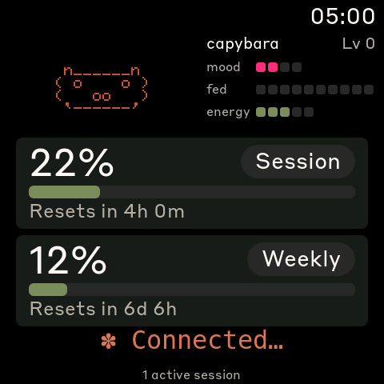
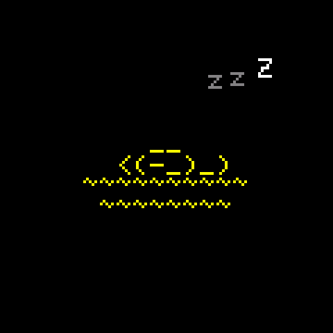
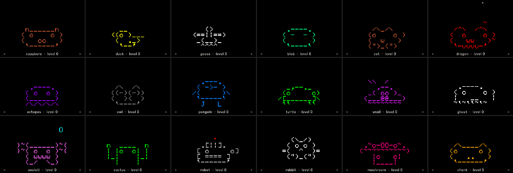
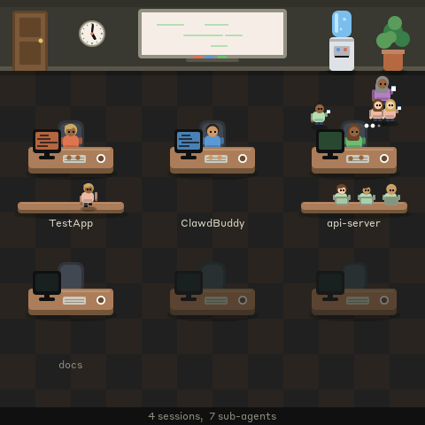
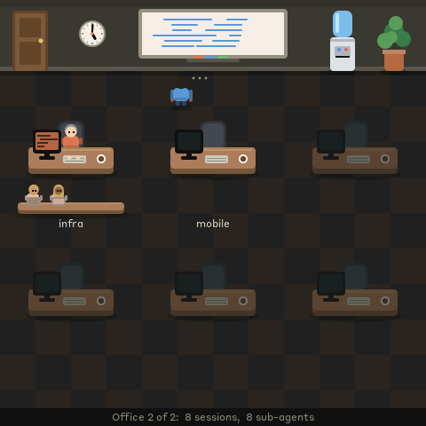
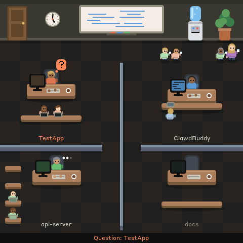
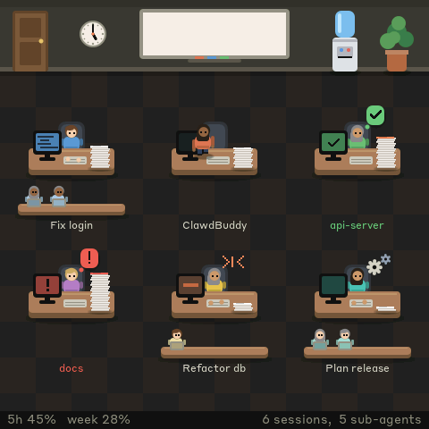
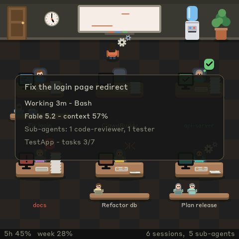
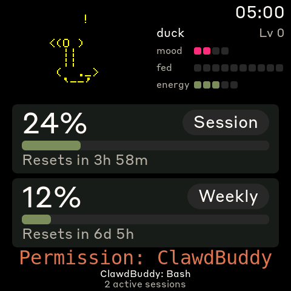

# ClawdBuddy

A desk companion for [Claude Code](https://claude.com/claude-code) on a
4-inch touch screen. It has two views:

- **The pet view:** your usage limits, with an ASCII pet that reacts to what
  Claude Code is doing and tells you which session is waiting for you.
- **The office view:** every running session as a desk in a small office,
  with its main agent and sub-agents as people who type, think at the
  whiteboard, wait for you, or take a break at the water cooler. A stack of
  paper on each desk shows how much of its context the session has used, a
  green tick says its turn is done, and a tap on a desk opens a card with
  the details.

A menu-bar app on your computer reads Claude Code's usage and hook events and
sends them to the screen over Bluetooth.

| The pet view | The office view |
| :---: | :---: |
|  |  |

<sub>All pictures on this page are from the simulator, which runs the same firmware as the board.</sub>

ClawdBuddy is built from two projects,
[Clawdmeter](https://github.com/HermannBjorgvin/Clawdmeter) and
[claude-desktop-buddy](https://github.com/anthropics/claude-desktop-buddy).
See [Acknowledgements](#acknowledgements).

## Contents

- [The pet view](#the-pet-view)
- [The office view](#the-office-view)
- [Alerts](#alerts)
- [Controls](#controls)
- [Materials](#materials)
- [Install](#install)
- [Settings](#settings)
- [Try it without a board](#try-it-without-a-board)
- [Build from source](#build-from-source)
- [Acknowledgements](#acknowledgements)
- [Licensing](#licensing)

## The pet view

| Meters | Pet and stats | Screensaver |
| :---: | :---: | :---: |
|  |  |  |

**Usage meters.** Up to two cards with a percentage, a bar and the time to
the next reset:

- With a 5-hour limit: **Session** and **Weekly**.
- On an account with no 5-hour limit: **Weekly**, and **Fable** when the
  account reports Fable's own weekly limit.

An optional pace marker shows how far into each window you are and turns a bar
amber when usage is ahead of it. A clock sits in the top right corner when the
app's clock setting is on.

**Three rows under the meters:**

1. A status word that changes while Claude works (`Pondering…`,
   `Brewing…`), or the alert when a session needs you.
2. The last session to run a tool, and the tool: `my-project: Bash`.
3. The number of sessions active in the last 5 minutes.

**The pet.** One of 18 ASCII pets lives in the top left corner, with its
name, level and three stats beside it.

**Uptime and idle time.** The two small figures in the bottom corners,
either side of the session count, each under its icon: on the left, under
the clock, how long the app has been running and connected to the board
(`121h05m`); on the right, under the moon, how much of that time no session
was working (every session done, idle or on a break, or none open). The
large pet's page spells them out
along the bottom: `Uptime: 121h05m / Idle: 52h00m`. The app keeps the totals,
so they carry on across restarts, updates, and a reset or a flash of the
board. They need app and firmware 0.2.1 or newer.



What the pet does:

| The pet is… | When |
| --- | --- |
| idle | Connected, and Claude Code is quiet |
| busy | Tools are running |
| alert | A session needs you; briefly, when you send a prompt |
| celebrating | A usage window reset; it gained a level |
| showing hearts | You tapped it; a long turn finished |
| dizzy | The main meter is at 100 % |
| asleep | No connection or stale data; on the screensaver |

What moves its stats:

| Stat | What moves it |
| --- | --- |
| **Level** and **fed** | Rises in the main usage meter. With a 5-hour limit: ten fed pips and one level per five full sessions. On an account with no 5-hour limit: a fed pip per 10 % of the week, a level per full week. |
| **Mood** | How well you keep your sessions unblocked. A session is held up by you while a question or a permission prompt is up, and for 15 minutes after its turn ends if nobody picks it up. The mood follows the share of your sessions held up, over about the last quarter hour: nearly none is the top mood, close to half or more the bottom. Time away from the computer (macOS) is not counted. |
| **Energy** | How much context the fullest session has left: five pips under 20 % used, one from 75 %, none from 90 %. It comes back when that session compacts or ends. Needs ClawdBuddy's status line; without it, energy is 3 of 5 at start-up, full after a rest on the screensaver, one less every 2 hours awake. |

Mood and energy come from the app, so they need app and firmware 0.1.4 or
later; with an older one of either, the pet uses its earlier rules (answer
times for mood, naps for energy).

The species, level and fed pips are saved on the board and survive a restart
or a reflash.

**Screensaver.** After a quiet stretch (10 minutes by default) the pet goes to
sleep, large, on a black screen. A prompt, an alert or a tap wakes it.

More detail: [docs/pet-view.md](docs/pet-view.md).

## The office view

| One office | A break at the water cooler | A second office |
| :---: | :---: | :---: |
|  |  |  |

Off by default. Turn on **Agent team view** on the app's Device page, then
tap the left or right side of the screen.

**Desks.** Each Claude Code session gets a desk, named after the session's
title (the one Claude Code shows for it) or, before it has one, its working
directory. A title too long for the desk (12 characters) is cut between
words. Two sessions that would read the same are numbered (`api`, `api 2`).
Sessions sit in the order they arrived and keep their desks, six to an
office.

**Two styles.** The app's Device page offers two looks for the office.
Everything else on this page works the same in both.

| Desks (the default) | Cubicles |
| :---: | :---: |
|  |  |
| Six sessions to an office | Four sessions to an office, one per cubicle |

In the cubicle style a plus-shaped partition splits the floor into four. Each
cubicle's desks stand one of three ways, mixed at random each time the board
starts: the sub-agents in a row in front of the main agent, across an island
from it, or down the side wall in an L.



People at the whiteboard and the water cooler each take their own spot along
the wall, and form a second row only when the first is full.

**The main agent** sits behind the desk:



| You see | It means |
| --- | --- |
| Typing, monitor lit with scrolling lines | A tool is running, however long it takes, or one just finished |
| Two gears turning over its head | Thinking: in a turn with no tool running. After six seconds it walks to the whiteboard and writes |
| At the whiteboard while tools run | Plan mode: the work is a plan |
| Gears, at the desk | Waiting for its sub-agents, during a turn or after it |
| A `?` bubble, the name in orange | Waiting for you: a permission prompt or a question |
| A green tick, the name in green | Its turn just ended: your move |
| A red `!`, the name in red | The turn ended on an API error, such as a usage limit |
| Arrows pressing in from both sides, a pulsing monitor | Compacting its context |
| Head down under a `z` | Three minutes after its turn ended |
| At the water cooler with a cup | Six minutes after its turn ended |

A desk keeps what it shows for at least eight seconds, so a main agent woken
by each of its sub-agents does not flicker; only a `?` appears and goes at
once. Compacting is the main agent's own: a sub-agent's is not shown.

**Paper for the context.** The stack of paper on a desk is how much of its
context window the session has used: as tall as the monitor when it is full.
The top sheet turns orange at three quarters and red at nine tenths, and the
stack sinks while the session compacts. A desk has a mug instead until the
app knows the figure, which comes from Claude Code's status line (see
[Settings](#settings)).

**A desk's card.** Tap a desk for the session's full title, what it is doing
and for how long, the tool running, the model, the context used, its
sub-agents by type, its task list's progress and the lines it has changed.
Tap again to close it.



**Sub-agents** are the smaller people on the bench in front of the desk, in a
lighter shade of their main agent's colour. Up to four are drawn; `+N` after
the name counts the rest. Now and then one walks to the whiteboard and back. A
sub-agent with no activity for 2 minutes waits at the water cooler.

**Coming and going.** Sessions and sub-agents walk in and out through the
door. A session arrives when it opens and leaves when it exits, when its
process is gone, or 15 minutes after its last turn ended. When one leaves,
the sessions after it move up a desk. A session is the same person in the
same colour each time it comes in.

**More sessions than desks.** The seventh session (the fifth, with cubicles)
opens another office, up to twelve sessions in all, and the bottom line
reads `Office 1 of 2`. Someone whose new desk is
in the other office walks out of one door and in at the other. An office with
nobody left is removed. With more than six sessions, names are cut to 8
characters.

**The bottom line** has the plan's usage on the left (`5h 45%  week 28%`, in
orange when a limit is used up) and, on the right, the sessions and
sub-agents in, or the alert.

**No connection.** When the board loses the computer, or hears nothing for a
minute and a half, the office is shut: lights off, nobody in, and the bottom
line says so. It opens again as it was when the connection is back.


**Also on screen:** the wall clock shows the real time, and the whiteboard
fills with what people write and is wiped when full.

More detail: [docs/office-view.md](docs/office-view.md).

## Alerts



When a session needs you, the board chimes and shows which one:

| Alert | When |
| --- | --- |
| `Permission: my-project` | Claude Code asks to run a tool |
| `Question: my-project` | Claude asks you a question |
| `Limit reached: my-project` | A usage limit stopped the session mid-turn |
| `Stopped on error: my-project` | Another API error ended the turn |

The alert clears when you answer in the terminal, when you tap the screen, or
after 2 minutes. On the office view the same text shows on the bottom line,
the session's desk gets the `?`, and if that desk is in another office the
view switches to it until the alert ends.

**While you are away.** On macOS the app knows when the keyboard and pointer
were last used. After three minutes without input an alert no longer times
out: it waits, and when you are back it chimes again and gets its two minutes
from then.

## Controls

| Where | Tap | Result |
| --- | --- | --- |
| Pet view | The pet or its stats | The large pet with its stats |
| Pet view, office view on | Left or right third of the screen | The next or previous view |
| Large pet | Left or right third | Previous or next species |
| Large pet | Middle | Back to the meters |
| Office view | A desk | That session's card; any tap closes it |
| Office view | Left or right third, off a desk | The next or previous view |
| Anywhere, during an alert | Anywhere | Dismisses the alert |
| Screensaver | Anywhere | Wakes the pet |

On the office view a tap on a desk is that desk's, so to switch views tap a
side of the screen away from the desks: the wall along the top always works.
The views form a ring: the pet view, then each office in turn. With the office view off, a tap anywhere on the pet view raises
the large pet.

The board's BOOT button sends a key to your computer (Space by default); the
app's Device page changes what it sends.

## Materials

- **Screen:** Waveshare ESP32-S3-Touch-LCD-4, 480×480 with touch. Pinout,
  schematic and board revisions are on the
  [Waveshare wiki](https://www.waveshare.com/wiki/ESP32-S3-Touch-LCD-4).
  Tested on the V4.0 revision, on USB power, without a battery.
- **Case:** [Clawdmeter case for the 4-inch screen](https://makerworld.com/en/models/3367042-clawdmeter-case-4-inch-screen#profileId-3829075)
  on MakerWorld, to 3D-print.
- **Cable:** USB-C, one that carries data.

This is the only board ClawdBuddy supports.

## Install

You need Claude Code, signed in to an account that reports usage limits, and
a computer with Bluetooth.

### 1. Install the app

Download the app for your system from the
[latest release](https://github.com/tfranovic/ClawdBuddy/releases/latest):

| System | File | Status |
| --- | --- | --- |
| macOS (Apple silicon and Intel) | `clawdbuddy-<version>-macos-universal.dmg` | Tested on Apple silicon |
| Windows | `clawdbuddy-<version>-windows-x86_64.msi` | **Not tested** |
| Linux | `clawdbuddy_<version>_amd64.deb` or `clawdbuddy-<version>-x86_64.AppImage` | **Not tested** |

The Windows and Linux apps are built by the same release job from the same
code, but nobody has run them with this firmware. Please open an issue if
one does not work.

On macOS the app is not notarised. The first time you open it, macOS blocks
it: go to **System Settings → Privacy & Security**, click **Open Anyway**,
then allow Bluetooth access. The app lives in the menu bar.

### 2. Flash the board

Plug the board into your computer by its USB port. The app's setup offers to
flash it: it downloads the firmware from the same release and writes it over
USB. You can do this again later from the **Flash** page, where **Check for
new versions** looks for a newer firmware at once.

If the board is not found, hold **BOOT**, press and release **PWR** (the
reset key on this board), release **BOOT**, and try again. Press **PWR**
afterwards to start the firmware.

To flash without the app, build from source (below).

### 3. Pair and set up

1. Pair the board: on macOS, **System Settings → Bluetooth → Connect** next
   to **ClawdBuddy**. It appears as a keyboard.
2. Open **Hooks** in the app, review the changes to Claude Code's
   `settings.json`, and save. Sessions that are already running pick the
   hooks up after a restart. **Send a test alert** checks the path from the
   app to the board.
3. On the **Device** page, turn on **Agent team view** if you want the
   office.
4. Turn on **Settings → Start at login** if you want it.

### Coming from Clawdmeter

ClawdBuddy replaces a Clawdmeter install on the same board:

1. Quit Clawdmeter and delete it. Install and open ClawdBuddy: it moves
   `~/.config/clawdmeter` to `~/.config/clawdbuddy` the first time it runs.
2. Flash the board from ClawdBuddy.
3. Remove **Clawdmeter** from your Bluetooth devices and pair **ClawdBuddy**.
4. Open **Hooks** and save: the old `clawdmeter hook` entries are replaced.
5. If Clawdmeter started at login, turn **Start at login** on again and, on
   macOS, delete `~/Library/LaunchAgents/com.clawdmeter.app.plist`.

## Settings

The app's **Device** page sets what the board does:

| Setting | What it does |
| --- | --- |
| Colors | The board's colours |
| Clock | 12-hour, 24-hour or off: the corner clock on the pet view and the wall clock in the office |
| Liveliness | How much the pet does on its own, from 1 (still) to 5 |
| Attention animation | How long the pet stays alert for an alert |
| Pace marker | Marks the elapsed share of each usage window on the bars |
| Agent team view | Turns the office view on |
| Office style | Desks or cubicles, each shown with a picture; appears when the office view is on |
| Button | What the BOOT button sends to your computer |
| Alert chime, session reset chime | The board's sounds |

The **Hooks** page installs and removes the Claude Code hooks, each with a
10-second timeout so a hook that can't start never holds Claude Code up. It
also sets ClawdBuddy as Claude Code's status line when you have none: one
line under the prompt (`Fable 5.2 · context 42% · 5h 45% · week 28%`), which
is how the app learns each session's context and gets the plan's usage after
every reply. A status line of your own is left alone; the desks then show no
paper. After updating the app, save the Hooks page once to get the new hooks. The
**Accounts** page picks which Claude Code account's usage is shown when you
have more than one.

Everything is stored in `~/.config/clawdbuddy/config`
(`%LOCALAPPDATA%\ClawdBuddy\config` on Windows). Some keys have no switch in
the app:

| Key | Default | Meaning |
| --- | --- | --- |
| `alert_on` | `permission, question, elicitation` | Which alerts the board shows. Add `idle` for one when a session has waited a minute for your next prompt. |
| `alert_project` | `on` | Name the waiting session in the alert. `off` shows `Permission needed!` and `Question for you`. |
| `release_repo` | `tfranovic/ClawdBuddy` | Where the app looks for firmware and app updates. |

### Unofficial releases

Development builds are published as pre-releases on the
[releases page](https://github.com/tfranovic/ClawdBuddy/releases), with a
version like `0.1.1-dev`. They have the newest features and the least
testing. Turn on **Settings → Unofficial releases** and the app offers them
like any other update: the app itself in the sidebar, the firmware on the
**Flash** page. Turn it off to go back to official releases only; the app
then stays on what it has until an official release overtakes it.

The app looks for a new release once a day. **Check for new versions** on
the **Flash** page, beside the board it found, looks at once. An app that
is itself a development build is then shown later development firmware too,
whatever the switch says. What the check finds is offered everywhere else as
well: the **Device** page names it beside the board's own version, and the
sidebar offers the matching app.

Version 0.1.0 has no such switch. To move from it to a development build,
download that build's app from the releases page once; it then flashes the
matching firmware.

### What the app reads and writes

- **Usage** comes from Claude Code's usage endpoint, with the sign-in Claude
  Code already stored.
- **Hooks** record the event's name, the session id, the sub-agent id, the
  tool's name or the notification's type, the name of the working directory,
  the permission mode, the model, and the session's title as Claude Code
  shows it. They never record a prompt, a tool's input or its output. The
  title is text Claude Code wrote about the conversation; it goes to the
  board and nowhere else.
- **The status line** command keeps each session's context %, model, usage
  windows, cost and lines changed.
- **The totals** (uptime and idle time) are two numbers in the `totals` file
  in the app's folder.
- **Claude Code's list of running sessions** (`~/.claude/sessions`) is read
  to see which sessions are still alive and whether each is busy, idle or
  waiting.
- Nothing is sent anywhere except to the board over Bluetooth, and to GitHub
  when the app checks for an update.

## Try it without a board

The simulator runs the firmware in a window. It needs
[PlatformIO](https://platformio.org/install/cli) and SDL2
(`brew install sdl2`, or `apt install libsdl2-dev`).

```bash
pio run -d firmware -e sim
cd firmware

# The pet view: the pet, its stats, alerts, the screensaver.
SIM_FAST=1 SIM_SCENARIO=sim/pets-tour.jsonl \
  SIM_TAPS="6500@120,80;10500@440,400;12500@440,400;14500@40,400;17500@240,240" \
  .pio/build/sim/program

# The office view.
SIM_FAST=1 SIM_SCENARIO=sim/team.jsonl SIM_TAPS="3000@440,300" .pio/build/sim/program

# The finer states, the paper for context, and a desk's card (the second tap).
SIM_FAST=1 SIM_SCENARIO=sim/team-states.jsonl SIM_TAPS="3000@440,300;10000@80,170" .pio/build/sim/program

# The cubicle style.
SIM_FAST=1 SIM_SCENARIO=sim/team-cubicles.jsonl SIM_TAPS="3000@440,300" .pio/build/sim/program

# Two offices, and desks closing up.
SIM_FAST=1 SIM_SCENARIO=sim/team-two-offices.jsonl \
  SIM_TAPS="3000@440,300;16000@440,100;40000@40,100" .pio/build/sim/program
```

Click in the window to tap; `esc` quits.

## Build from source

See [docs/development.md](docs/development.md) for the firmware, the app, the
tests and how a release is made. In short:

```bash
pio run -d firmware -e waveshare_lcd_4 -t upload   # firmware, over USB
cargo run --release --manifest-path desktop/Cargo.toml -p clawdbuddy-app
```

## Acknowledgements

ClawdBuddy is a combination of two projects. Neither is affiliated with it.

**[Clawdmeter](https://github.com/HermannBjorgvin/Clawdmeter) by Hermann
Björgvin Haraldsson and its contributors.** ClawdBuddy started as a fork of
Clawdmeter and most of its code is Clawdmeter's:

- The firmware's foundation: the Waveshare board support, Bluetooth, the
  payload parser, the usage meters and their layout, themes, the clock, the
  pace marker, chimes, the button actions, the simulator, and the "director"
  that decides when the mascot idles, reacts, alerts and goes to the
  screensaver. The pets are driven by that director in the mascot's place.
- The desktop app: reading usage, the hook installer and hook handling,
  alerts, Bluetooth, the flasher, the settings window and the tray.
- The release tooling and packaging.

What ClawdBuddy changed in it: the support for every other board was removed,
the Clawd mascot was replaced by the pets, the pet view's layout and the
office view were added, along with sub-agent tracking, limit alerts, alerts
that name their session, the tool and session rows, and the Fable meter on
weekly-only accounts.

**[claude-desktop-buddy](https://github.com/anthropics/claude-desktop-buddy)
by Anthropic.** The 18 ASCII pets come from it:

- The species files in `firmware/src/pet/buddies/` are its code, unchanged
  apart from a build guard.
- `firmware/src/pet/pet_buddy.cpp` is a port of its drawing helpers, changed
  to draw into a plain pixel buffer so the pets also run in the simulator.
- The rules for the pet's stats (`firmware/src/pet/pet_stats_core.cpp`)
  follow its design, adapted to the inputs this device receives.

Also used: the 5×7 font from Adafruit's GFX library (BSD), for the pets.

## Licensing

See [LICENSE](LICENSE). In short:

- **ClawdBuddy's own additions** (the office view, the pet integration and
  the changes listed above) are MIT-licensed, © 2026 Tin Franovic.
- **The pet code from claude-desktop-buddy** is MIT-licensed, © 2026
  Anthropic, PBC ([LICENSE-buddy](firmware/src/pet/LICENSE-buddy)).
- **Code inherited from Clawdmeter** stays under Clawdmeter's terms. Its
  desktop crates are declared MIT; its repository has no licence file, and
  its author's warning applies to this repository too, because the same
  fonts and artwork are still in this tree:

  > The software in this repository uses and adheres to the Anthropic brand guidelines and uses the same proprietary fonts that Anthropic has a license for but this software uses without permission as well as using assets from Anthropic such as the copyrighted Clawd mascot so even though the code in this repo is non-proprietary I will not license it myself under a copyleft license since this repo includes proprietary fonts and copyrighted assets. Please be aware of this if you fork or copy the code from this repo. **You have been warned!**

- **The fonts** (Styrene, Tiempos) and **the Clawd artwork** belong to their
  owners and are not covered by any licence here.

"Claude" and "Claude Code" are Anthropic's. ClawdBuddy is an unofficial
project and is not affiliated with or endorsed by Anthropic.
