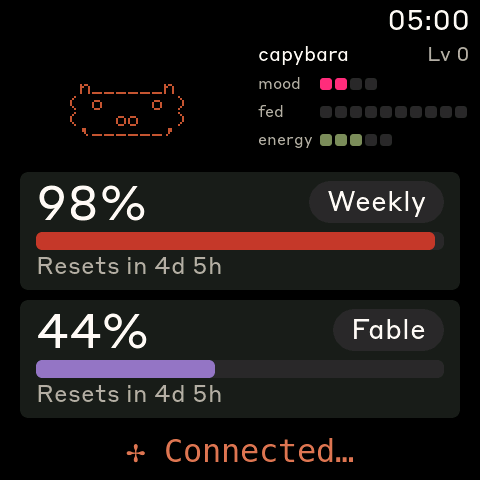
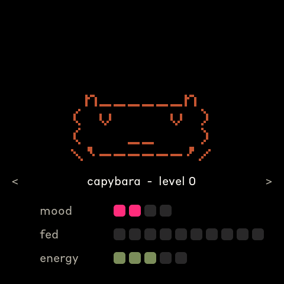
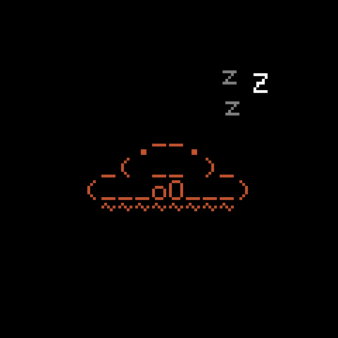
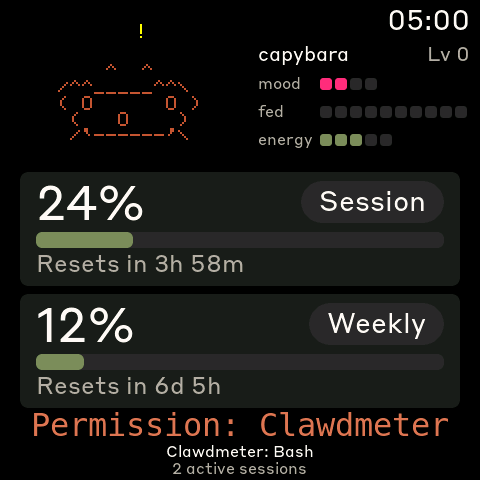

# Clawdmeter with ASCII pets

A fork of [HermannBjorgvin/Clawdmeter](https://github.com/HermannBjorgvin/Clawdmeter)
for the 4-inch Waveshare ESP32-S3-Touch-LCD-4. It shows your Claude Code
usage limits on a screen on your desk, with an ASCII pet in place of Clawd.
The pet reacts to what Claude Code is doing, and the screen tells you which
session is waiting when one needs an answer.

| Meters | Stats | Screensaver | Alert |
| :---: | :---: | :---: | :---: |
|  |  |  |  |
| Weekly and Fable usage | Tap the meters | After a quiet stretch | A session needs you |

<sub>Screenshots from the simulator.</sub>

## What you get

From the original Clawdmeter, unchanged:

- Usage meters with reset countdowns, read from Claude Code by a menu-bar
  app and sent to the board over Bluetooth.
- Alerts with a beep when a session asks for permission or asks a question.
  They clear when you answer in the terminal.
- Themes, a clock, a pace marker and the other settings on the app's Device
  page.

Added by this fork:

- **ASCII pets.** The 18 pets from
  [claude-desktop-buddy](https://github.com/anthropics/claude-desktop-buddy)
  sit in the corner of the meters: idle, busy while Claude works, alert when
  a session needs you, celebrating a reset, dizzy at 100 %.
- **Pet screensaver.** After a quiet stretch the pet sleeps, large, on a
  black screen.
- **Stats and species.** Tap the meters for the large pet with its level,
  mood, fed and energy. Tap the left or right third of the screen to change
  species; tap the middle to go back.
- **Alerts name the session.** The alert line reads `Permission: my-project`
  or `Question: my-project`, using the name of the session's working
  directory, so you know which terminal to go to.
- **Limit alerts.** When a usage limit stops a session mid-turn, the screen
  beeps and reads `Limit reached: my-project` instead of carrying on as if
  Claude were still working. Other API errors read `Stopped on error: …`.
- **An agent team view.** An optional second screen draws your sessions as
  an office: a desk per session (a second office opens past six), the main agent behind it, its sub-agents
  on a bench in front. People type, walk to the whiteboard to think, raise
  a `?` when they wait for you, and doze between turns. Turn it on with
  **Agent team view** on the app's Device page, then tap the left or right
  side of the screen to switch. See [docs/pets.md](docs/pets.md#the-agent-team-view).
- **A Fable card.** On an account with no 5-hour limit, Fable's weekly limit
  gets its own meter under the Weekly one.

### How the pet's stats move

| Stat | What moves it |
| --- | --- |
| Level, fed | Rises in the usage meter. On an account with no 5-hour limit: a fed pip per 10 % of the week, a level per full week. With a 5-hour limit: a level per five full sessions. |
| Mood | How quickly alerts are answered: under 15 seconds is the top mood, over 2 minutes the bottom. Alerts left to time out pull it down. |
| Energy | 3 of 5 at start-up, full after a rest on the screensaver, one less every 2 hours awake. |

The rules and the pet's states are in [docs/pets.md](docs/pets.md).

## Materials

- **Screen:** Waveshare ESP32-S3-Touch-LCD-4, 480×480 with touch. Pinout,
  schematic and board revisions are on the
  [Waveshare wiki](https://www.waveshare.com/wiki/ESP32-S3-Touch-LCD-4).
  Tested on the V4.0 revision, on USB power, without a battery.
- **Case:** [Clawdmeter case for the 4-inch screen](https://makerworld.com/en/models/3367042-clawdmeter-case-4-inch-screen#profileId-3829075)
  on MakerWorld, to 3D-print.
- **Cable:** USB-C, one that carries data.

## Install

The fork publishes no releases, so the firmware and the app are built from
this repository. These steps are for macOS, which is where they were run.

You need:

- [PlatformIO](https://platformio.org/install/cli) for the firmware.
- [Rust](https://rustup.rs) for the app. The version in
  `desktop/rust-toolchain.toml` installs itself on the first build.
- Xcode with its Metal Toolchain: `xcodebuild -runFirstLaunch`, then
  `xcodebuild -downloadComponent MetalToolchain`.
- Claude Code, signed in to an account that reports usage limits.

### 1. Flash the board

Plug the board in by its USB port, then:

```bash
pio run -d firmware -e waveshare_lcd_4_pets -t upload
```

The board restarts, beeps once and shows the meters with the pet in the
corner.

If the upload can't connect, hold **BOOT**, press and release **PWR** (the
reset key on this board), release **BOOT**, and run the command again. Press
**PWR** afterwards to start the firmware.

### 2. Build and install the app

```bash
tools/packaging/local-mac-app.sh
cp -R desktop/target/dist/Clawdmeter.app /Applications/
```

Open Clawdmeter from Applications. macOS blocks the first launch because the
app is only ad-hoc signed: go to **System Settings → Privacy & Security**,
click **Open Anyway**, then allow Bluetooth access. The app lives in the
menu bar.

### 3. Set up

1. **Skip the firmware step in setup, and don't use the Flash page.** The app
   sees the board as a stock `waveshare_lcd_4` and would replace the pet
   build with the official firmware.
2. Add `update_check = off` to `~/.config/clawdmeter/config` to stop the
   update prompts (**Settings** links to the file).
3. Pair the board: **System Settings → Bluetooth → Connect** next to
   **Clawdmeter**. It appears as a keyboard.
4. Open **Hooks** in the app, review the changes to Claude Code's
   `settings.json`, and save. Sessions that are already running pick the
   hooks up after a restart.
5. Turn on **Settings → Start at login** if you want it.

**Send a test alert** on the Hooks page checks the path from the app to the
board.

## Settings

Everything in the original [user guide](docs/user-guide.md) applies. The
fork adds one key to `~/.config/clawdmeter/config`:

| Key | Default | Meaning |
| --- | --- | --- |
| `alert_project` | `on` | Name the waiting session in the alert line. `off` restores the fixed lines, `Permission needed!` and `Question for you`. |

The chosen species and the pet's stats are kept on the board and survive a
restart or a reflash.

## Try it without a board

The simulator runs the same firmware in a window:

```bash
pio run -d firmware -e sim_pets
cd firmware
SIM_FAST=1 SIM_SCENARIO=sim/pets-tour.jsonl \
SIM_TAPS="6500@240,240;10500@440,400;12500@440,400;14500@40,400;17500@240,240" \
.pio/build/sim_pets/program
```

That plays a two-minute tour: the seat, the stats and three species changes,
two alerts, a busy stretch, the screensaver, 100 % and a reset. Click the
window to tap; `m` raises an alert, `a` cycles activity, `esc` quits.

## Other boards and the stock firmware

The pet build is a compile-time option (`-DPET_ASCII`). It has environments
for the 4-inch Waveshare screen (`waveshare_lcd_4_pets`) and the simulator
(`sim_pets`) only. Every board and environment of the original still builds
from this tree with Clawd, and gets the two changes that are not behind the
flag: project-named alerts and the Fable card. For the list of supported
boards and the official releases, see the
[original repository](https://github.com/HermannBjorgvin/Clawdmeter#supported-boards).

To go back to the stock firmware, flash it from the app's Flash page.

## Docs

- [ASCII pets](docs/pets.md): the pet build's design, states, stats rules and files.
- [User guide](docs/user-guide.md): device controls, settings, and connection help.
- [Development](docs/development.md): builds, simulator, and releases.
- [BLE protocol](docs/protocol.md): payload fields and notifications.
- [Clawd's director](docs/clawd-director.md): the behaviour rules the pet follows too.
- [Add a board](docs/porting/adding-a-board.md): hardware ports and app integration.

## Licensing

The pet code under `firmware/src/pet/buddies/` comes from
claude-desktop-buddy and is MIT-licensed
([LICENSE-buddy](firmware/src/pet/LICENSE-buddy)).

The rest carries the original repository's warning, which still applies
here because its fonts and Clawd assets remain in this tree:

> The software in this repository uses and adheres to the Anthropic brand guidelines and uses the same proprietary fonts that Anthropic has a license for but this software uses without permission as well as using assets from Anthropic such as the copyrighted Clawd mascot so even though the code in this repo is non-proprietary I will not license it myself under a copyleft license since this repo includes proprietary fonts and copyrighted assets. Please be aware of this if you fork or copy the code from this repo. **You have been warned!**
