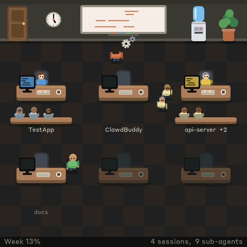

# The office view

The second of ClawdBuddy's two views: Claude Code sessions as desks in an
office. For what you see and how to use it, start with the
[README](../README.md#the-office-view); this page has the rules behind it and
where the data comes from.



## Where the data comes from

Claude Code runs the app's hook on these events:

| Hook | Used for |
| --- | --- |
| `UserPromptSubmit` | A turn started: the main agent is thinking |
| `PostToolUse` | A tool ran. Inside a sub-agent the event carries its `agent_id`, which shows that sub-agent is alive |
| `PreToolUse` (AskUserQuestion), `Notification` | Waiting for you |
| `Stop`, `StopFailure` | The turn ended |
| `SubagentStart`, `SubagentStop` | A sub-agent came or went |
| `SessionEnd` | The session left |

Every call appends one line to `team.log` in the app's folder: the time, the
event, the session id, the sub-agent id, the tool's name or the notification's
type, and the name of the working directory. Never a prompt, or a tool's input
or output.

The app folds the last hour of that file into the sessions to show
(`desktop/crates/clawdbuddy-core/src/team.rs`) and sends them to the board as
the `tm` field ([protocol](protocol.md)).

## A session's state

| State | Sent as | Rule |
| --- | --- | --- |
| Working | `w` | The main agent ran a tool in the last 10 seconds |
| Thinking | `t` | In a turn, no tool call from the main agent for 10 seconds |
| Waiting | `q` | A permission prompt, a question or an elicitation dialog is up |
| Delegating | `d` | The turn ended and sub-agents are still running |
| Idle | `i` | The turn ended, less than 2 minutes ago |
| On a break | `b` | The turn ended 2 minutes ago or more |

Two things are inferred, because Claude Code has no event for them:

- **Thinking** is "no tool call for 10 seconds", so one long-running command
  looks the same.
- **A sub-agent's end** is sometimes not reported. A sub-agent with no event
  for 10 minutes is taken as gone; after 2 minutes it is counted as quiet and
  stands at the water cooler.

A session leaves when it exits (`SessionEnd`), 15 minutes after its last turn
ended, or after an hour without any event.

## The scene

The firmware keeps the scene and draws it at 480×480, fifteen times a second
(`firmware/src/pet/team_core.cpp`, pure and tested by `test_team`). The names
and the bottom line are text labels over it (`pet/team_view.cpp`).

- Sessions sit in the order the app sends them, which is the order they
  started: six to an office with the desks skin, four with cubicles. Twelve
  sessions is what fits one Bluetooth write (two offices of desks, three of
  cubicles); with more than six, names are cut to 8 characters.
- The skin comes in the `tv` field (1 desks, 2 cubicles; `team_skin` in the
  app's config). In the cubicle skin a plus of partitions makes four
  cubicles, with a gap either side of its centre where people walk. Each
  cubicle's sub-agent desks are a row, the far side of an island, or the
  upright of an L; which cubicle gets which is drawn from a number picked
  when the board starts, so neighbours never match.
- When a session leaves, every session after it moves up one desk. A person
  whose new desk is in the other office walks to the door of one and comes in
  at the door of the other.
- Each session keeps the shirt colour it was given when it arrived (the one
  fewest sessions were wearing). Sub-agents wear a lighter shade.
- The main agent goes to the whiteboard after 3 seconds of thinking and comes
  back when the state changes. Sub-agents visit it at random while their
  session works.
- While the view is off screen nobody walks: arrivals are simply at their
  desks the next time it comes up.

The view's picture takes 460 KB of the board's PSRAM, allocated the first
time it is shown.

## Trying it

```bash
cd firmware
SIM_FAST=1 SIM_SCENARIO=sim/team.jsonl SIM_TAPS="3000@440,300" .pio/build/sim/program
SIM_FAST=1 SIM_SCENARIO=sim/team-cubicles.jsonl SIM_TAPS="3000@440,300" .pio/build/sim/program
SIM_FAST=1 SIM_SCENARIO=sim/team-two-offices.jsonl \
  SIM_TAPS="3000@440,300;16000@440,300;40000@40,300" .pio/build/sim/program
```

A scenario is one JSON payload per line, with a `hold_ms`; edit the `tm`
values to stage other situations.
