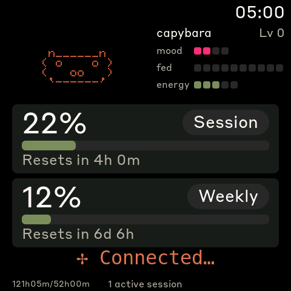

# The pet view

The first of ClawdBuddy's two views: the usage meters, with an ASCII pet.
For what you see and how to use it, start with the [README](../README.md#the-pet-view);
this page has the rules behind it and where they live in the code.

## Layout

On the 480×480 panel (`place_pet_home` in `firmware/src/layout.cpp`):

| Area | What is there |
| --- | --- |
| Top left, 240×164 | The pet's whole canvas at 2× (`pet/pet_mascot.cpp`) |
| Top right | The clock, when the app sends the time; under it the pet's name, level, and the mood, fed and energy pips (`pet/pet_home.cpp`) |
| Middle | Two usage cards, 114 px tall |
| Bottom | Three centred rows: the status word or the alert; the last session to run a tool (`lt`); the number of active sessions (`n`) |

## The meters

| Account | First card | Second card |
| --- | --- | --- |
| With a 5-hour limit | Session | Weekly |
| No 5-hour limit (`acct: "week"`) | Weekly | Fable, when the app sends `wf` |

At 100 % the pet is dizzy. When a window resets it celebrates, and the board
chimes if the reset chime is on.

## The pet's states

The firmware's director (`clawd_director.cpp`) decides what the pet does. It
was written for Clawdmeter's mascot; the pets implement the same three
interfaces (`mascot.h`, `performer.h`, `face.h`).

| Pet state | When |
| --- | --- |
| sleep | The screensaver; in its corner, no connection or stale data |
| idle | Connected, no hook activity |
| busy | Hook activity above zero |
| attention | An alert is up; a prompt arriving (a moment) |
| celebrate | The usage window reset; a level gained; a "show" on a busy stretch |
| heart | A tap; the first seconds of the large pet; a long turn finishing |
| dizzy | The main meter at 100 % |

**The large pet.** A tap on the pet or its stats raises it, awake, with its
stats under it. A tap in the left or right third steps to the previous or
next species (saved on the board); a tap in the middle, or about ten seconds
without one, sends it back.

**The screensaver.** After ten minutes without hook activity the pet sleeps,
large, on black. The **Liveliness** setting changes how readily it does this
and how much the pet does on its own.

## Stats

The rules are in `firmware/src/pet/pet_stats_core.cpp` (pure, tested by
`test_pet_stats`).

| Stat | Input | Rule |
| --- | --- | --- |
| Level, fed | Rises in the main usage meter | 500 percentage points a level, ten fed pips each: five full sessions. On an account with no 5-hour limit the meter is the week and its rises count five times: a level per full week, a pip per 10 %. Replays, resets and a change of account kind feed nothing. |
| Mood | `ps`, first digit | Worked out by the app (`team::PetMood`): the share of the office's sessions held up by the user, as an average that forgets about two thirds every 15 minutes. Under 6 % is 4, under 15 % 3, under 30 % 2, under 45 % 1, else 0. Not updated while the user is away. Without `ps` (an older app): the median seconds from an alert arriving to the computer clearing it (last 8), lowered when more than a third of alerts run into the timeout. |
| Energy | `ps`, second digit | Worked out by the app (`team::pet_energy`) from the highest context % among the sessions: under 20 is 5, under 40 4, under 60 3, under 75 2, under 90 1, else 0. When no context is known the app sends `-` and the board's own rule applies: 3 of 5 at boot, full after a screensaver rest of a minute or more, one less every 2 hours. |

A tap that dismisses an alert on the board counts as neither an answer nor a
timeout. Permission alerts reach the board about six seconds after the prompt
appears (Claude Code delays that notification), so answer times read about
six seconds short.

Stats are saved to flash (NVS namespace `pet`) on events only: an answer, a
timeout, a level, a fed pip, and at most every ten minutes of napping.

## Files

| File | Role |
| --- | --- |
| `pet/buddies/*.cpp`, `buddy.h`, `buddy_common.h` | The 18 species, from claude-desktop-buddy |
| `pet/pet_buddy.cpp` | The drawing helpers the species call, over a 120×82 canvas and a 5×7 font; the species choice |
| `pet/pet_view.cpp` | One LVGL image showing that canvas at a whole-number scale |
| `pet/pet_mascot.cpp` | The pet in its corner |
| `pet/pet_face.cpp` | The large pet, its stats, the species taps, the screensaver |
| `pet/pet_home.cpp` | The stats beside the pet and the two rows under the status word |
| `pet/pet_hooks.cpp` | Inputs from `main.cpp`, the pet's resting state, saving |
| `pet/pet_stats_core.cpp` | The stats rules |
