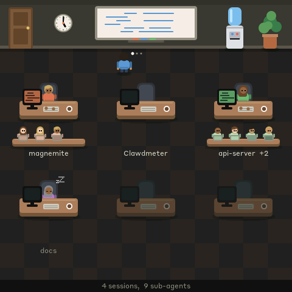

# ASCII pets

A build with `-DPET_ASCII` replaces Clawd with the 18 ASCII pets from
[claude-desktop-buddy](https://github.com/anthropics/claude-desktop-buddy)
(MIT; `firmware/src/pet/LICENSE-buddy`). The meters, alerts, Bluetooth and
board code are unchanged. Two environments set the flag:

```bash
pio run -d firmware -e sim_pets && (cd firmware && .pio/build/sim_pets/program)
pio run -d firmware -e waveshare_lcd_4_pets -t upload
```

`waveshare_lcd_4_pets` reports itself to the app as `waveshare_lcd_4` (same
board, same settings). The app's Flash page offers the official firmware,
which would replace this build: skip it, set `update_check = off`, or point
`release_repo` at a repository that publishes the pet image.

## What you see

| Where | Stock | Pet build |
| --- | --- | --- |
| The seat on the meters | Corner Clawd | The pet, 2× on a 480 panel (1× on small ones) |
| The meters on a 480×480 panel | Header row (Clawd, title, battery), two 150 px cards | No header: the pet's whole canvas top left, its stats beside it (`pet_home.cpp`), a small clock top right when the app sends the time, two 114 px cards (`place_pet_home` in `layout.cpp`). Under the cards, three centred rows: the cycling word (or an alert), the last session to run a tool with the tool's name (`lt`), the number of active sessions |
| Shows | Full-size Clawd performs | Acts in the seat (the path boards without PSRAM take) |
| Screensaver | Clawd's face | The pet, large and asleep, on black |
| Tap on the meters (the peek) | Clawd's face, curious | The pet, large and awake, with its stats |
| An alert | Big Clawd walks on | The pet's attention animation, in the seat |

On the peek, a tap in the left or right third of the screen steps to the
previous or next species (saved on the device); a tap in the middle sends
the pet back to its seat.

On panels other than 480×480 the seat sits at the top edge, so the overlays
the species draw above the body (Zs, hearts, exclamation marks) are mostly
cut off there. They show in full on the large pet.

## The agent team view

Off by default; **Agent team view** on the app's Device page (`team_view = on`)
turns it on. 480×480 panels only.



| You see | It means |
| --- | --- |
| A desk with a name under it | A session, named after its working directory. Sessions sit in the order they started, six to an office. A seventh opens a second office (twelve sessions at most: what one Bluetooth write holds; names are cut to 8 characters while it is open). When a session leaves, the ones after it move up a desk, through the door when that desk is in the other office, and an office left empty is gone. |
| The person behind the desk | The session's main agent. Typing with the monitor lit: running tools. At the whiteboard: in a turn with no tool call for 10 seconds or more (thinking, or one long tool). A `?` bubble and an orange name: waiting for you. Awake with thinking dots over its head: its turn is over but its sub-agents are still running. Head down under a `z`: between turns. At the water cooler with a cup: between turns for 2 minutes or more. |
| Smaller people on the bench in front | Its sub-agents, up to four; `+N` after the name counts the rest. Now and then one walks to the whiteboard and back. One with no event for 2 minutes waits at the water cooler until it does something or times out. |
| The wall clock | The app's time, when the clock setting is on; no hands otherwise. |
| People walking to or from the door | A session or a sub-agent starting or ending. |
| The bottom line | Sessions and sub-agents, or the alert. |

A session leaves 15 minutes after its last turn ended, or when it exits.

Controls with the view on: a tap in the left or right third of the screen
steps through the views, which form a ring: the meters, the first office,
the second when there is one. The bottom line says which office is up. On the meters, a tap on the pet
or its stats raises the large pet; the cards do nothing. With the view off,
any tap on the meters raises the large pet, as before.

Where the data comes from: every hook call appends a line to `team.log` in
the app's state folder (time, event, session id, sub-agent id, tool or
notification type, project name; never a prompt or a tool's input). Three
hooks exist only for this: `SubagentStart`, `SubagentStop` and `SessionEnd`.
The app folds the last hour into the `tm` field (`team.rs`); the firmware
keeps the scene and draws it at 480×480 (`pet/team_core.cpp`, tested by
`test_team`); the names and the bottom line are labels over it
(`pet/team_view.cpp`). Claude Code sometimes drops a
sub-agent's stop event, so a sub-agent silent for 10 minutes is taken as gone,
and the end of a turn clears the bench.

```bash
SIM_FAST=1 SIM_SCENARIO=sim/team.jsonl SIM_TAPS="3000@440,300" .pio/build/sim_pets/program
# two offices, and desks closing up:
SIM_FAST=1 SIM_SCENARIO=sim/team-two-offices.jsonl \
  SIM_TAPS="3000@440,300;16000@440,300;40000@40,300" .pio/build/sim_pets/program
```

## States

| Pet state | When |
| --- | --- |
| sleep | The screensaver; in the seat, no connection or stale data |
| idle | Connected, no hook activity |
| busy | Hook activity above zero |
| attention | An alert is up; a prompt arriving (a moment) |
| celebrate | The usage window reset; a level gained; a show |
| heart | A tap; the first seconds of the peek; a long turn finishing |
| dizzy | The main meter at 100 % |

## Stats

Shown under the large pet on the peek. The rules are in
`firmware/src/pet/pet_stats_core.cpp` (pure, tested by `test_pet_stats`); they
come from the buddy firmware with inputs this device actually receives.

| Stat | Input | Notes |
| --- | --- | --- |
| Level, fed | Rises in the main usage meter | 500 percentage points a level (`PET_POINTS_PER_LEVEL`), ten "fed" pips each: five full sessions. On an account with no 5-hour limit the meter is the week and its rises count five times (`PET_WEEK_WEIGHT`): a level per full week, a pip per 10 %. Replays, resets, Codex numbers and a change of account kind feed nothing. |
| Mood | How alerts end | The median seconds from an alert arriving to the computer clearing it (last 8). Lowered when more than a third of alerts run into the 2-minute timeout. |
| Energy | Naps | 3 of 5 at boot, full after a screensaver rest of a minute or more, one less every 2 hours. |

A tap that dismisses an alert on the device counts as neither an answer nor
a timeout. Permission alerts reach the device about six seconds after the
prompt appears (Claude Code delays that notification), so answer times read
about six seconds short.

Stats are saved to NVS (namespace `pet`) on events only: an answer, a
timeout, a level, a fed pip, and at most every ten minutes of napping.

## How it fits

The director (`clawd_director.cpp`) talks to its actors only through
`mascot.h`, `performer.h` and `face.h`. The pet build excludes the three
stock implementations (`build_src_filter`) and compiles `src/pet/` instead;
every file there is wrapped in `#ifdef PET_ASCII`, except the pure stats
rules.

| File | Role |
| --- | --- |
| `pet/buddies/*.cpp`, `buddy.h`, `buddy_common.h` | The species, unchanged from the buddy firmware apart from the build guard |
| `pet/pet_buddy.cpp` | The drawing helpers the species call, over a 120×82 RGB565 canvas and a 5×7 font (no Arduino_GFX, so it builds in the simulator); species choice |
| `pet/pet_view.cpp` | One LVGL image showing that canvas at a whole-number scale |
| `pet/pet_mascot.cpp` | `mascot.h`: the seat. Leaving and returning are a short slide through the left edge |
| `pet/pet_performer.cpp` | `performer.h`: unavailable, so shows play in the seat |
| `pet/pet_face.cpp` | `face.h`: the large pet on `lv_layer_top()`, the stats, the species taps |
| `pet/pet_hooks.cpp` | Inputs from `main.cpp`, the pet's resting state, NVS |
| `pet/pet_stats_core.cpp` | The stats rules |

Edits outside `src/pet/`: three hook calls in `main.cpp` (empty inlines in a
stock build), the species tap in `director_tap()` (`#ifdef PET_ASCII`), and
the environments in `platformio.ini`.

When upstream adds a function to `mascot.h`, `performer.h` or `face.h`, the
pet build stops linking until the pet module gets it too.

## Checking a change

```bash
pio test -d firmware -e native -f test_pet_stats
cd firmware
SDL_VIDEODRIVER=dummy SIM_FAST=1 SIM_TRACE=1 SIM_SCENARIO=sim/director.jsonl \
  SIM_SHOTS="4000:/tmp/seat.bmp,60000:/tmp/screensaver.bmp" .pio/build/sim_pets/program
```

The walkthrough should reach the end with every beat returning to `home`.
`SIM_TAPS="6000@240,240;9800@440,400"` raises the peek and steps the species.
