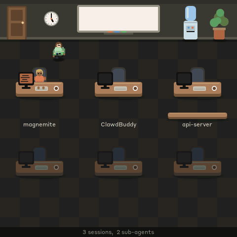
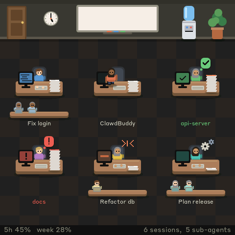
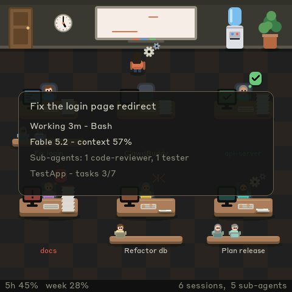
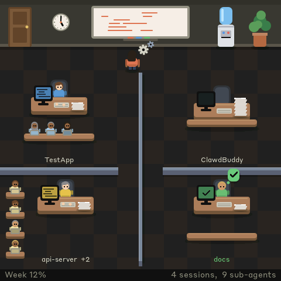
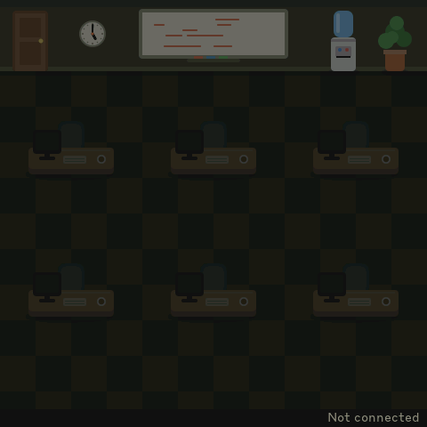
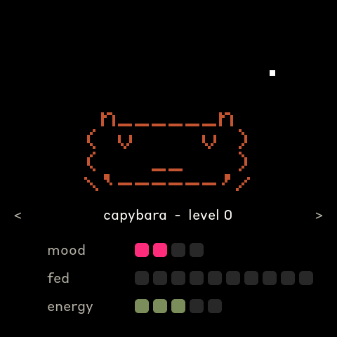

# ClawdBuddy 0.2.0

The office view grows up. In 0.1.0 it showed who was working and who was
waiting. Now each desk tells you how full the session's context is, whether
it finished, failed or is compacting, and a tap opens a card with the
details. The pet's mood and energy mean something, alerts wait for you when
you step away, and the usage meters move after every reply.

## Before you update

Both halves changed, so update both:

1. **Update the app**, from its sidebar or from the files below.
2. **Open the Hooks page and save once.** This version listens to more of
   Claude Code's events and adds a status line; nothing new arrives until you
   save.
3. **Flash the board** from the app's Flash page.

The two are built to tolerate each other across versions (each ignores what
it doesn't know), but you only get the new features with both updated.

## What's new

### Desks that say more

- **Paper for context.** A stack of paper on each desk shows how much of its
  context window the session has used. It is as tall as the monitor when the
  window is full; the top sheet turns orange at three quarters and red at
  nine tenths.
- **Gears for thinking.** A larger and a smaller gear turn over the agent's
  head, replacing the three dots.
- **Done, failed, compacting.** A green tick when a turn ends (your move), a
  red `!` when it ends on an API error such as a usage limit, and arrows
  pressing in while the session compacts.
- **Plan mode** works at the whiteboard.
- **Better names.** A desk is named after the session's title, the one Claude
  Code shows, instead of its folder. Two sessions that would read the same
  are numbered (`api`, `api 2`).
- **Truer states.** A long-running tool is work however long it takes. An
  interrupted turn ends at once. A session whose process is gone leaves
  straight away instead of lingering.

### A card for each desk

Tap a desk for its card: the session's full title, what it is doing and for
how long, the tool in use, the model, the context used, its sub-agents by
type, its task list's progress and the lines it has added and removed. Tap
again to close it.

### Cubicles

A second look for the office, chosen on the app's Device page: four cubicles
to an office, each with its sub-agents' desks in a row, around an island or
in an L.

### The office at a glance

- **Usage on the bottom strip.** The office view now shows your plan's usage,
  so you don't have to switch back to the meters.
- **Alerts find their office.** When a session in the other office needs you,
  the view switches there until the alert ends.
- **Lights off when there's no data.** With no connection the office is shown
  shut, so you never mistake an old picture for a live one.

### A pet that reflects your day

- **Mood** follows how many of your sessions are held up waiting for you: a
  question or permission prompt left open, or a finished turn nobody picked
  up. Keep them moving and the pet is happy. Time you spend away from the
  computer doesn't count against you.
- **Energy** is the context left in your fullest session. It drains as that
  session fills and comes back when it compacts or ends.

### Alerts that wait for you (macOS)

If you haven't touched the keyboard or pointer for three minutes, an alert no
longer times out while nobody is there to see it. When you come back it is
raised again, with its chime, and gets its full two minutes from then.

### Meters that keep up

The app can now be Claude Code's status line. Claude Code hands it your usage
after every reply, so the meters move between polls instead of every few
minutes. It is also where the paper on the desks comes from. If you already
have a status line of your own, the app leaves it alone; the desks then show
a mug instead of paper.

### Unofficial releases

**Settings → Unofficial releases** offers pre-release builds of the app and
the firmware, for trying new features early.

## Fixes

- Desks no longer swap places when two sessions have both been busy for more
  than an hour.
- A sub-agent compacting its context no longer shows the main agent as
  compacting for ten minutes.
- A desk keeps what it shows for at least eight seconds, so an agent woken by
  each of its sub-agents no longer flickers between states.
- Tapping the office works whatever the pet is doing. Taps used to be ignored
  while the pet was mid-animation.
- The weekly meter could show an old, lower figure taken from an idle
  session.
- A sub-agent working in its own folder no longer renames the session's
  project or the last-tool line.
- A title too long for a desk is cut between words, not mid-word.
- People at the whiteboard and the water cooler no longer stand on top of
  each other.

## Under the hood

- Hooks now cover tool starts and failures, permission requests, session
  start and end, compaction and task lists, each with a 10-second timeout.
  They still never record a prompt or a tool's input or output. What they do
  record is listed in the README under
  [What the app reads and writes](https://github.com/tfranovic/ClawdBuddy/blob/v0.2.0/README.md#what-the-app-reads-and-writes).
- New payload fields `tx`, `td`, `aw` and `ps`, documented in the
  [protocol](https://github.com/tfranovic/ClawdBuddy/blob/v0.2.0/docs/protocol.md).
- The app's log marks each day with a date line and no longer grows without
  limit.
- The room's fixed parts are drawn once and copied each frame.

## Known limits

- Stepping-away detection is macOS only for now; on Windows and Linux alerts
  time out as before.
- The paper, the pet's energy and the faster meters need ClawdBuddy's status
  line.
- With more than six sessions, names are cut to 8 characters to fit a second
  office.

More on how it all works:
[the office view](https://github.com/tfranovic/ClawdBuddy/blob/v0.2.0/docs/office-view.md)
and [the pet view](https://github.com/tfranovic/ClawdBuddy/blob/v0.2.0/docs/pet-view.md).
