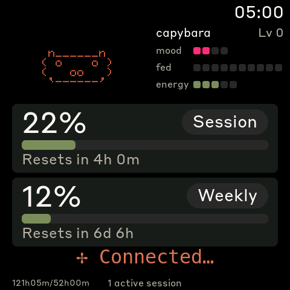
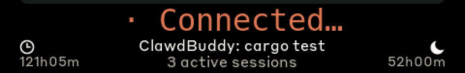
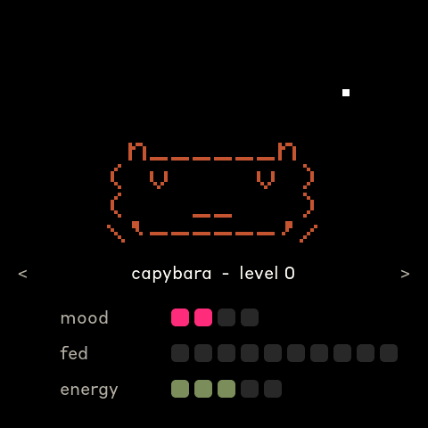

# ClawdBuddy 0.3.0

How long has the buddy been on your desk, and how much of that time was
nobody working? 0.3.0 keeps count. The board now shows the total time the
app has been running and connected, and how much of it passed with no
session at work. The app also gets a button to look for new firmware when
you want it, not once a day.

## Before you update

Both halves changed, so update both:

1. **Update the app**, from its sidebar or from the files below.
2. **Flash the board** from the app's Flash page.

There is nothing to save on the Hooks page this time. An updated app with
an older board (or the other way round) keeps working as before; the two
timers only appear once both are on 0.3.0.

## What's new

### Uptime and idle time

Two running totals sit in the bottom corners of the meters, either side of
the session count:

- **Uptime**, on the left under the clock: how long the app has been
  running and connected to the board. Time with the app closed, the board
  unplugged or the computer asleep is not counted.
- **Idle time**, on the right under the moon: how much of that uptime
  passed with no session working. That means every open session was done,
  failed, idle or on a break, or no session was open at all. A session
  waiting for your answer counts as work in progress, not as idle.

Both read as hours and minutes, like `121h05m`. The gap between the two is
the time at least one session was busy.

**They survive everything.** The app keeps the totals, not the board, so
they carry on across an app restart, an app update, and a reset or a new
flash of the board. Between updates from the app the board counts on by
itself, and stops while the connection is down. The count starts the first
time you run 0.3.0.

The large pet's page spells the same two figures out along the bottom:

To make room, the line that names the last tool now stops short of the two
icons; a long one is cut before it reaches them.

### Check for new versions

The app looks for a new release once a day. The **Flash** page now has a
**Check for new versions** button, beside the board it found, that looks
at once and tells you what it found: a newer version, or that you already
have the latest. If the check fails (no network, say), the version already
on screen stays ready to install.

What the button finds is offered everywhere else too: the **Device** page
shows it beside the board's own version, and the sidebar offers the
matching app.

If you run a development build of the app, the button also finds later
development builds, whether or not **Unofficial releases** is on. An
official app is still only shown official releases unless you turn that
setting on.

## Fixes

- **The Device page named the old firmware after a flash.** It kept the
  version it read over USB when the page was first opened, so after
  flashing from the Flash page it still showed the one before. It now shows
  what was last flashed or read, and asks the board again each time the
  page is opened.
- **A new release found by one window didn't show in the rest of the app**
  until the app was restarted. It now shows at once.

## Under the hood

- A new payload field, `ut`, carries the totals: uptime in seconds, idle
  time in seconds, and whether the app is idle now. It is sent on
  connecting, when the idle state changes and every ten minutes, and is
  among the first fields left out when a write would not fit. Older
  firmware ignores it. See the
  [protocol](https://github.com/tfranovic/ClawdBuddy/blob/v0.3.0/docs/protocol.md).
- The totals live in a `totals` file in the app's folder, saved once a
  minute. A gap of more than 30 seconds between two counts (the computer
  slept) is not counted.
- The two icons are drawn by the firmware itself and take the theme's text
  colour, so they follow a light or dark theme.

## Known limits

- The totals count from the first run of 0.3.0; earlier time is not
  recovered.
- There is no button to reset the totals. Deleting the `totals` file while
  the app is closed starts them again from zero.
- Past 999 hours the figures grow by a digit and sit closer to the session
  count.

More on how it works: [the pet view](https://github.com/tfranovic/ClawdBuddy/blob/v0.3.0/docs/pet-view.md).
